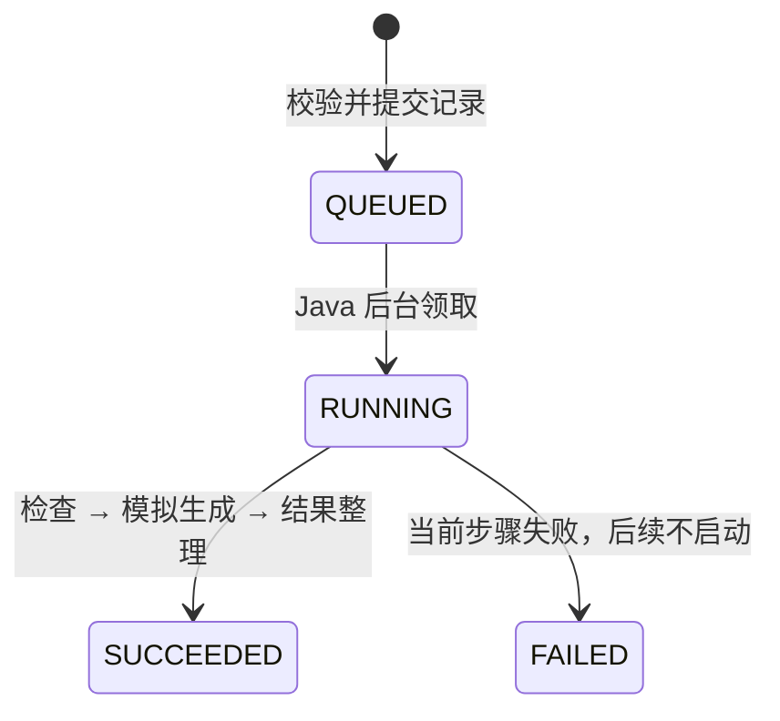

# 第四阶段：异步任务与结果

## 数据与执行

`005-tasks.sql` 增加 tasks、task_assets（输入顺序）、task_steps。受理短事务包含所有记录；未提交的数据不会被工作器看到。后台单线程每 500ms 选择一条 QUEUED，用条件更新领取为 RUNNING，依次执行三个阶段。下一任务等上一任务结束后领取。积压保存在数据库，当前未限制任务数量；演示环境不要批量灌入大量任务。



每步先提交 RUNNING 及开始时间，然后执行延迟／模拟工作，再提交 SUCCEEDED 及结束时间。任务成功与 FINALIZE 步骤完成、结果名在同一事务发布；步骤失败与任务失败同一事务发布。前端与 GET 均不修改执行状态。读取任务及步骤使用一致性快照，避免组合到不同提交的状态。

素材检查重新确认输入文件可用；模拟生成仅延迟；结果整理通过临时文件及原子移动（不支持时普通移动）复制第一张输入图片。它是预置规则的模拟作品，不合成多图。复制结束不等于发布成功，数据库成功后才有结果 URL；普通失败会清理未发布文件，进程崩溃仍可能留下孤立文件。

默认每步 1500ms。页面可设 0–30000ms 和任一失败阶段。参数随任务持久化，后续修改控件不会影响已有任务。0ms 适合测试，阶段边界仍有持久化记录，但 UI 未必来得及看到执行中。

## 页面演示

1. 打开 `http://localhost:3000`，选择小陈，进入「萌宠写真」等单图模板。
2. 点击使用示例图，等待已上传；开始制作后按钮恢复，右侧立即出现已受理任务。
3. 点击右侧「查询 / 刷新」观察排队、阶段和成功图片。可再创建一个任务，各自独立。
4. 展开「模拟制作设置」，耗时设 3000，指定模拟生成失败；提交后查询，检查失败原因、失败阶段和未开始的结果整理。
5. 刷新页面后恢复身份，点击查询读回本模板历史；切换小林，再查询，不能看到小陈记录。
6. 当前尚无自动轮询：阶段不会靠前端定时变文案。第五阶段增加自动跟踪与刷新自动恢复。

提交中按钮禁用并有请求锁。受理成功后即可继续创建；本阶段没有后端幂等键。提交网络异常时提示结果不确定，应先查询历史确认，避免盲目重复提交。查询暂时失败保留任务信息，显示独立错误并可重新查询；查询错误不改任务为 FAILED。

## 主要请求／响应

已有三阶段数据卷先执行增量 SQL（新空卷无需手动）：

```bash
docker compose exec -T mysql sh -c 'MYSQL_PWD="$MYSQL_PASSWORD" mysql --default-character-set=utf8mb4 -u"$MYSQL_USER" "$MYSQL_DATABASE"' < database/init/005-tasks.sql
docker compose up --build -d --wait
```

以下命令在宿主机终端执行，Cookie 文件位于临时目录，不提交仓库：

```bash
curl -i -c /tmp/xiaoying-task.cookies -H 'X-Studio-Request: 1' -H 'Content-Type: application/json' \
  -d '{"userId":"demo-chen"}' http://localhost:3000/api/auth/session
curl -o /tmp/xiaoying-sample.png http://localhost:3000/demo/sample-1.png
curl -b /tmp/xiaoying-task.cookies -H 'X-Studio-Request: 1' \
  -F templateId=pet-portrait -F 'file=@/tmp/xiaoying-sample.png;type=image/png' http://localhost:3000/api/assets
```

将上传响应的 `id` 填入下面的 `素材ID`，双图模板需两个不同且同属该模板的 ID：

```bash
curl -i -b /tmp/xiaoying-task.cookies -H 'X-Studio-Request: 1' -H 'Content-Type: application/json' \
  -d '{"templateId":"pet-portrait","assetIds":["素材ID"],"simulation":{"stepDelayMs":3000,"failAtStage":"GENERATE"}}' \
  http://localhost:3000/api/tasks
curl -b /tmp/xiaoying-task.cookies http://localhost:3000/api/tasks/任务ID
curl -b /tmp/xiaoying-task.cookies 'http://localhost:3000/api/tasks?templateId=pet-portrait'
```

成功请求中省略 `simulation` 或设 `failAtStage: null`。失败枚举：`MATERIAL_CHECK / GENERATE / FINALIZE`；每步同样的 `stepDelayMs`；缺省 1500，上限 30000。202 示例（字段节选）：

```json
{"id":"任务UUID","ownerId":"demo-chen","templateId":"pet-portrait","status":"QUEUED","stage":null,"errorMessage":null,"resultUrl":null,"simulation":{"stepDelayMs":3000,"failAtStage":"GENERATE"}}
```

完整响应另含 UTC 创建／更新时间、结束时间和三个步骤。成功时 `resultUrl=/api/tasks/{id}/result`；失败时当前 `stage` 保留，`errorMessage` 为中文原因，后续步骤仍 WAITING。所有查询 no-store；结果有正确图片 MIME 和 nosniff。不存在、越权、未生成结果为 404；数量／重复／模板不匹配／非法模拟参数为 400；未登录 401；缺少写请求头 403；数据库不可用由统一处理器返回 503。

## 可重复验证

```bash
# 真实 MySQL 集成测试与 Java 构建
docker compose --profile checks run --build --rm backend-check
# 容器内执行真实 HTTP 验收，无需宿主机 Node
# 给小陈保留一条成功、一条模拟失败的非个人示例任务，并退出测试会话
docker compose exec -T frontend node --input-type=module < tools/smoke-tasks.mjs
# 前端状态模型测试等：在 frontend 目录执行
npm run lint
npm test
npm run typecheck
npm run build
```

本轮 Java 共 27 项，通过；新增任务 9 项（含三个失败阶段的参数化用例），覆盖受理排队、查询不推进、顺序、失败中断、执行中边界、终态稳定、缺失文件、多任务与越权。使用 latch 暂停真实工作器并读取库中 RUNNING，避免只靠毫秒计时猜测异步行为。测试关闭自动领取，使用临时素材目录，仅清理自己的记录。

前端共 10 项状态测试，其中新增任务 4 项覆盖多个任务的结果／失败独立、查询错误保留已有状态、恢复查询、查询异常期间新建任务和非法响应。不是完整 React 挂载或浏览器测试，取消旧请求和自动跟踪将继续补验。

真实 HTTP 验收已观察到三个阶段、成功／失败、结果字节一致、历史恢复读取和其他用户 404。本次受理约 50ms / 19ms，配置每阶段 700ms；计时只是本机观测，不是性能保证。完整浏览器交互尚未验证，不能将 HTTP 检查等同 UI 验收。

## 边界与运维

- 仅支持单 Java 实例。启动时将原 RUNNING 标为失败并注明中断；QUEUED 可继续领取。成功／失败终态不会被恢复逻辑重置。未实现执行中断点续跑。
- 数据库在阶段写入时中断，可能留下 RUNNING，需服务重启标记中断；不自动重试任务。
- 没有队列容量、用户速率限制、幂等键、自动重试、执行超时、自动孤立文件清理。数量和磁盘使用适用于本地演示。
- 多图模板验证全部输入并保存顺序，模拟结果按第一张复制；不是实际图片合成。
- 刷新不恢复上传位选择，已创建任务／素材保留。列表最多最近 100 条，无分页；全量历史入口和自动查询在下一阶段。
- 回滚只回滚应用并保留数据卷。005 为新增表，回到第三阶段应用可以忽略任务表；不要直接删除任务／素材表或数据卷。最终发布仍应先备份并核对数据库兼容性。
